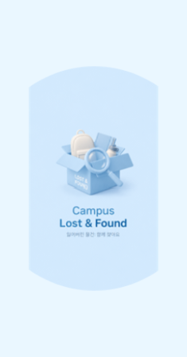
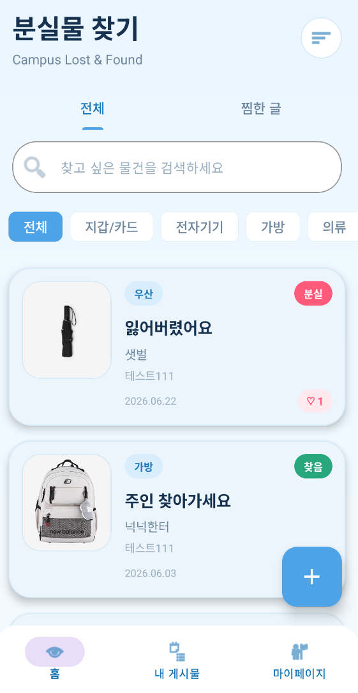
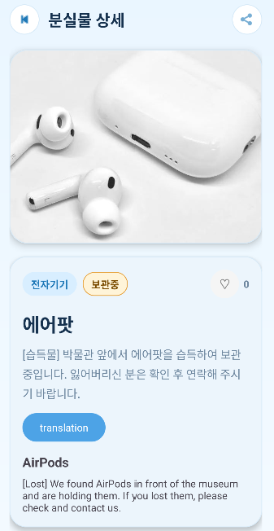
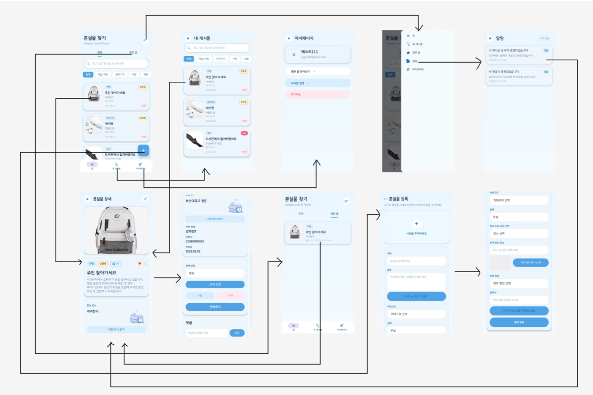

# Campus Lost & Found

**캠퍼스 분실물 관리 Android 애플리케이션**

  

    
  

  

    
  

  

    
  

대학교 캠퍼스 내에서 발생하는 분실물과 습득물을 효율적으로 등록하고 검색할 수 있도록 개발한 Android 애플리케이션입니다.

기존의 에브리타임, 인스타그램 등 여러 채널에 흩어져 있던 분실물 정보를 하나의 플랫폼에서 관리할 수 있도록 기획하였으며,
사진, 위치, 카테고리, 상태 등의 정보를 제공하며 AI와 외부 API를 활용해 사용자 편의성을 높였습니다.

---

## 1. 프로젝트 개요

- **프로젝트명:** Campus Lost & Found
- **프로젝트 유형:** Android 애플리케이션
- **개발 형태:** 팀 프로젝트
- **개발 인원:** 2명
- **담당 역할:** UI 개발 및 외부 API 연동
- **개발 환경:** Android Studio
- **주요 언어:** Kotlin

### 개발 목적

- 캠퍼스 내 분실물 정보 공유의 접근성 향상
- 분실물 및 습득물 정보의 체계적인 관리
- 위치와 사진 정보를 활용한 탐색 편의성 개선
- AI 및 외부 API를 활용한 사용자 입력 부담 감소

## 2. 주요 기능

### ① 분실물 및 습득물 관리

- 분실물 및 습득물 게시글 등록, 수정, 삭제
- 사진 첨부 및 상세 정보 확인
- 카테고리, 제목, 설명, 장소 기반 검색
- 게시글 상태 관리

### ② 지도 및 위치 정보

- Google Maps API를 활용한 분실 위치 선택
- 지도에서 분실 위치 확인
- Google Static Maps API를 활용한 위치 미리보기

### ③ AI 기반 기능

- TensorFlow Lite 기반 분실물 이미지 카테고리 추천
- Gemini API 기반 게시글 자동 작성 및 문장 보정
- 이미지 분석 결과가 부족한 경우 키워드 기반 추천 활용

### ④ 번역 기능

- Google Cloud Translation API를 활용한 게시글 번역
- 게시글 제목 및 설명의 영어 번역 지원

### ⑤ 사용자 관리 및 커뮤니티

- 회원가입 및 로그인
- 즐겨찾기 및 관심 게시글 관리
- 마이페이지 및 내 게시글 확인
- 댓글 작성 및 삭제
- 게시글 상태 변경 및 관심 게시글 관련 알림

## 3. 담당 역할 및 기여

프로젝트에서 UI 개발과 외부 API 연동을 중심으로 담당했습니다.

### UI 개발

- 메인 화면 및 탭 화면 구현
- 하단 내비게이션 및 사이드 내비게이션 구현
- 즐겨찾기 목록 및 관심 게시글 관리 화면 구현
- 마이페이지 및 사용자 정보 화면 구현
- 내 게시글 목록 화면 구현

### 외부 API 연동

**Google Maps API**
- 분실 위치 선택 기능 구현
- 지도 화면 및 위치 표시 기능 구현

**Google Static Maps API**
- 선택한 위치를 지도 이미지로 미리보기할 수 있도록 구현

**Google Cloud Translation API**
- 게시글 제목 및 설명 번역 기능 구현
- API 요청 및 응답 데이터 처리

### 팀 공동 구현

- 로그인 및 회원가입 흐름 연동
- 게시글 목록 조회, 검색 및 필터링 개선
- 게시글 상세 화면 및 댓글 기능 구현
- 상태 변경 및 알림 기능 구현
- RecyclerView 어댑터 및 데이터 모델 구성
- 전체 화면 통합 및 기능 테스트

## 4. 기술 스택

| 구분 | 사용 기술 |
|---|---|
| Language | Kotlin |
| Development | Android Studio |
| Database | Firebase Authentication, Cloud Firestore |
| Map API | Google Maps API |
| Static Map | Google Static Maps API |
| Translation | Google Cloud Translation API |
| AI | TensorFlow Lite, Gemini API |
| Image Loading | Glide |
| Async Processing | Kotlin Coroutine |
| Android Jetpack | RecyclerView, Fragment, ViewPager2, DrawerLayout, ViewBinding |

## 5. 개발 과정에서의 문제 해결

### 외부 API 연동 및 데이터 처리

Google Maps API와 Google Cloud Translation API를 연동하면서 네트워크 요청과 응답 데이터 처리 과정을 경험하였으며,
API 요청 과정에서 발생할 수 있는 오류를 고려하여 예외 처리와 오류 상태 안내를 적용했습니다.

### 비동기 처리

Firebase 데이터 조회 및 외부 API 호출 과정에서 UI가 멈추지 않도록 Coroutine과 lifecycleScope를 활용했습니다.

### 안정성 확보

- 입력값 검증 및 예외 처리
- API 호출 실패 시 오류 안내
- 지도 위치 정보 유효성 확인
- 중복 요청 방지
- 비동기 작업 중 진행 상태 표시

## 6. 프로젝트 결과

분실물 등록부터 목록 조회, 상세 정보 확인, 댓글 및 즐겨찾기, 알림, 지도 확인까지 이어지는 사용자 흐름을 구현했습니다.

또한 AI 기반 카테고리 추천과 게시글 자동 작성, 번역 기능을 결합하여 기존의 단순한 분실물 게시판과 차별화된 서비스를 구성했습니다.

이번 프로젝트를 통해 Android 애플리케이션 개발뿐만 아니라 외부 API 연동, 네트워크 통신, JSON 데이터 처리 및 예외 처리의 중요성을 경험할 수 있었습니다.

## 7. 프로젝트 링크

- GitHub Repository: [프로젝트 소스 코드](https://github.com/yj0602/2026-sw-term-project.git)
